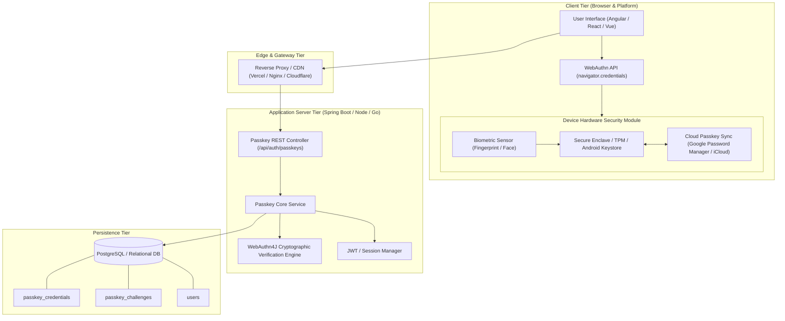
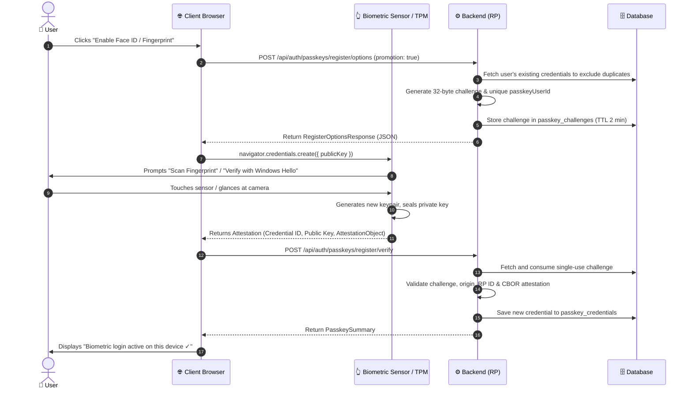
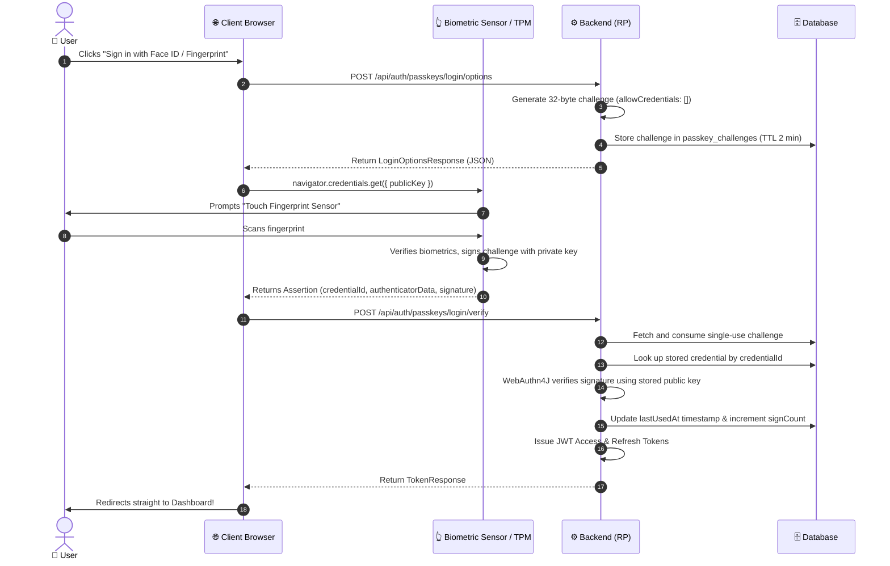

# High-Level Design (HLD): Biometric & Passkey Authentication System

## 1. Executive Summary
This document outlines the High-Level Design for a production-grade, passwordless Biometric & Passkey authentication system based on the W3C Web Authentication API (WebAuthn Level 3) and FIDO2 standards.

The system allows users to securely register their physical device authenticators (such as Windows Hello fingerprint/face, Android BiometricPrompt fingerprint scanner, Apple Touch ID / Face ID, or external FIDO2 security keys like YubiKeys) and subsequently authenticate in under a second without typing a username or password.

---

## 2. High-Level Architecture

---

## 3. Core Architectural Principles & Security Guarantees

### 3.1 Zero-Knowledge Biometric Isolation
- **Websites NEVER receive or see raw biometric data** (fingerprint images, facial geometry, iris scans).
- Biometric verification occurs strictly on-chip within the device hardware (Apple Secure Enclave, Android StrongBox/Keystore, or Windows TPM).
- The biometric sensor unlocks the private key inside the hardware. The hardware then creates a digital signature and returns only the signature.

### 3.2 Asymmetric Public-Key Cryptography
- **Registration**: The client authenticator creates a unique public/private keypair (typically ES256 / ECDSA P-256 or RS256).
- **Public Key**: Exported and stored on the server's database (`passkey_credentials`).
- **Private Key**: Permanently sealed inside the device hardware / synced passkey keychain. It cannot be extracted.

### 3.3 Phishing Resistance & Origin Binding
- The browser enforces strict cryptographic binding between the client's current origin (e.g. `https://peerdsatracker.com`) and the Relying Party ID (`rpId`).
- If an attacker clones the login page onto `https://evil-phishing.com`, the browser passes `evil-phishing.com` as the origin to the authenticator. The authenticator refuses to sign for the real RP ID, neutralizing 100% of credential phishing and man-in-the-middle (MitM) attacks.

### 3.4 Replay Attack Protection (Cryptographic Nonces)
- Every registration and login ceremony begins with the server issuing a cryptographically secure, high-entropy 32-byte challenge.
- The challenge is single-use and has a strict Time-To-Live (TTL = 120 to 300 seconds).
- The client signs this challenge. Once consumed by the server, the challenge record is deleted/invalidated. An intercepted request cannot be replayed.

### 3.5 Clone Detection via Signature Counters
- Authenticators track a monotonically increasing signature counter (`signCount`).
- Each successful authentication checks that `newSignCount > oldSignCount` (for single-device authenticators). If a counter regresses or freezes while cloning is suspected, the backend flags/rejects the credential.

---

## 4. Key Ceremonies & Workflows

### 4.1 Biometric Registration Ceremony (Enrollment)

### 4.2 Biometric Authentication Ceremony (Sign In)

---

## 5. Modern UX & Mediation Modes

1. **Explicit Button Sign-In**: Dedicated button (`Sign in with Face ID / Fingerprint`) for direct modal interaction.
2. **Conditional UI (Discoverable Autofill)**: Username input tagged with `autocomplete="username webauthn"`. When focused, the browser natively displays saved biometric passkeys directly in the autofill dropdown.
3. **Signal API Synchronization**: Keeps external password managers (Google Password Manager, 1Password, Bitwarden, iCloud Keychain) in sync with the server when credentials are deleted or rejected.
